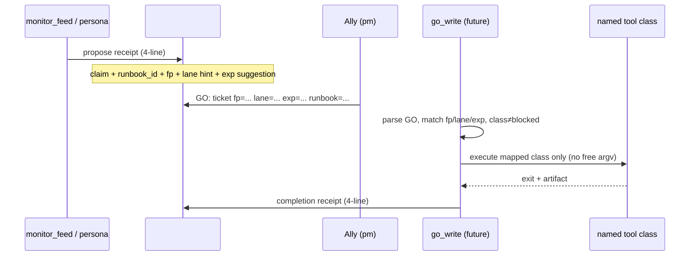

# GO-token write path — design spec (implementation deferred)

**Status:** draft spec only — **no production write-path wiring** in this PR.  
**Priority gate elsewhere:** [P2 homelab wake](../CHIP_MONITOR_P2.md) (merged #148) must be **live-deployed and rehearsed** (`CHIP_FEED_HOMELAB_WAKE`) before scoped writes are implemented. This slice is the **next** agent capability after read-only homelab tell-tier receipts.

**Tracker:** Linear RAZ-16 (comment `learning:` when the impl PR lands — not this doc PR).

---

## Ally law (non-negotiable)

| Rule | Meaning |
| --- | --- |
| No general shell agent | Extend **named runbook / tool classes** only; argv comes from registry rows, not model-invented shell. |
| Solo default | One persona per GO + completion receipt (topology verdict: solo unless Ally names a handoff). |
| Bare `GO:` is not enough | Propose-class writes need **`fp=` `lane=` `exp=`** on the same line as the human GO (see below). |
| Ally owns Infisical | Do not invent secrets or webhook URLs. |
| Rehearse in `#chip-dev` | Propose receipts and scoped-write receipts post via `CHIP_WEBHOOK_DEV`; keep `#monitoring-logs` unwired. |
| Deny wins | Registry **`blocked`** and global lane denies beat any GO. |

---

## Runbook classes (source of truth)

File: `config/chip_chat/runbooks.json` (merged in `chip.runbooks`).

| Class | Runbook ids | Agent behavior |
| --- | --- | --- |
| **auto** | `restart-named-service`, `clear-stale-suppress`, `re-run-health-probe`, `post-learning` | May run without propose card **only** when existing auto-heal gates pass (`authorize` + `may_autorun` + probe receipt). **Not** part of this GO-token write path. |
| **propose** | `discord-bot-loop-restart`, `al-9501-dead-image`, `compose-recreate`, `disk-cleanup`, `encode` | Post **propose receipt** → wait for Ally scoped GO → run **one** mapped named tool → post **done/refused receipt**. |
| **blocked** | `remux`, `plex-restart`, `credential-flip`, `media-delete` | Always refuse; GO does not override. Four-line blocked receipt (see `scripts/chip_relay/refusal.py` pattern). |
| **unknown id** | any other string | Fail-closed to **propose** (never auto). |

Homelab feed receipts already **name** propose runbooks in the `next:` line (e.g. `compose-recreate stays propose`) — they do **not** execute them (`scripts/chip_relay/homelab_probes.py`).

---

## End-to-end flow (target)



### 1. Propose receipt (post to `#chip-dev`)

Fixed **four-line** shape (same family as homelab receipts):

```text
claim: propose <runbook_id> for fp=<fingerprint>
status: propose
evidence: <probe or alert key; machine-checkable>
next: Ally GO: GO: <ticket> fp=<fp> lane=<lane> exp=<ISO-8601Z> runbook=<runbook_id>
```

- **`fp`** should match `chip.monitor.fingerprint_for(key, detail)` for the fault that triggered the propose card (or an explicit runbook fingerprint like `al-9501-dead-image`).
- **`lane`** is the execution lane (`razzorstack`, `chip`, `ops`, …) — must match GO.
- **`exp`** is a **future** UTC timestamp; parser rejects missing or expired markers.

**Poster:** dedicated webhook username (one persona per chain — default **`homelabdev`** or **`chipchatdev`** per Ally routing; spec default **`homelabdev`** for homelab runbooks, **`chipchatdev`** for chip-chat repo writes). No LLM turn required for the propose line itself (mirror P2 feed: structured post only).

### 2. Ally GO marker (parse — partially exists)

Parser today: `scripts/chip/go_scope.py` (`parse_scoped_go`, `propose_go_marker`).

Required on the GO line:

```text
GO: <ticket> fp=<fingerprint> lane=<lane> exp=<YYYY-MM-DDTHH:MM:SSZ> [runbook=<id>]
```

| Check | Reject reason |
| --- | --- |
| missing `fp=` or `lane=` or `exp=` | `deploy/absorb needs GO fp= lane= exp=` (message reused for all propose writes) |
| `exp` not in the future | `scoped GO expired` |
| `fp` mismatch vs pending propose | `scoped GO fingerprint mismatch` (new — impl) |
| `lane` mismatch vs pending propose | `scoped GO lane mismatch` (new — impl) |
| runbook class `blocked` | blocked four-line receipt; no tool call |
| runbook class `propose` but no matching open propose | refuse: `no matching propose receipt` (new — impl) |
| bare `GO: ticket` without scoped fields | refuse for **write** classes (wake/read may still use named ticket only — see `lanes.chipchatdev_wake_allowed`) |

Env pin for ticket name (existing): `CHIP_LANE_GO_TICKET` must equal the `<ticket>` token when build/deploy paths run (`lanes.py`). Scoped write path should **reuse** the same pin for consistency.

### 3. Scoped tool execution (deferred — named classes only)

**Not in this PR.** Target module: `scripts/chip/go_write.py` (stub only).

Each **propose** runbook id maps to exactly one **pre-declared** executor entry (no subprocess builder from natural language):

| Runbook id | Planned named action (sketch) | Notes |
| --- | --- | --- |
| `compose-recreate` | `compose-recreate` tool row (TBD in `chip_tools.json`) | Bounded `docker compose up -d --force-recreate --no-deps <unit>` from pinned compose dir; **Windows apply runner is a separate later item** — chip-chat may receipt-only until apply hook exists. |
| `clear-stale-suppress` | monitor state mutation class | Registry is **auto** today; if invoked via GO path, still requires scoped GO when class is propose-tier in a skill template. Prefer first impl on `compose-recreate` or a **dry-run stub** tool. |
| `disk-cleanup` | `disk-cleanup` tool row (TBD) | Proposal-only until argv allowlisted. |
| `al-9501-dead-image` | refuse / receipt only | Stay propose; soak law in `docs/ops/al-9501-dead-image.runbook.md`. |
| `encode` | TBD | Low priority. |
| `discord-bot-loop-restart` | mapped restart tool | Must pass `authorize.SERVICE_ALLOWLIST` (`discord-bot`, `monitoring-api` only). |

Execution gates (all required):

1. `runbooks.runbook_class(id) != "blocked"`
2. `parse_scoped_go(go_text)` OK and matches pending propose
3. `authorize.authorize(persona, scope, "execute", tool=<mapped>, …)` with live claim
4. `lanes.refuse_blob` / global denies
5. Stand-down off (`chip_relay.dispatch.stand_down`)
6. **No** `CHIP_TOOL_AUTO` bypass for propose-class writes

### 4. Completion receipt

```text
claim: executed <runbook_id> for fp=<fp>
status: done|refused|blocked
evidence: tool=<id> exit=<code> sha256=<artifact hash or none>
next: <verify probe id>|hold for Ally
```

Append audit row to `CHIP_CHAT_DATA_DIR/audit/go_write.jsonl` (new file — planned).

---

## Allow / deny matrix (must be unit-tested in impl PR)

Rows: action = attempt scoped write for runbook **R** with GO text **G**.

| R class | G scoped & valid | fp/lane match propose | Expected |
| --- | --- | --- | --- |
| blocked | yes | yes | **deny** (blocked receipt) |
| blocked | no | * | **deny** |
| propose | yes | yes | **allow** → named tool (happy path) |
| propose | yes | no | **deny** (mismatch) |
| propose | no (bare GO) | * | **deny** |
| propose | expired exp | * | **deny** |
| propose | yes | yes but no propose receipt | **deny** |
| auto | * | * | **out of scope** for GO path (existing auto-heal) |
| unknown id | yes | yes | treat as propose (fail-closed) |

Additional rejects (existing tests to extend):

- `go_scope.propose_go_marker` — missing fields, expired exp (`scripts/test_homelab_feed.py`)
- `lanes.chipchatdev_wake_allowed` — deploy/absorb scoped GO (`scripts/test_chip_lanes.py`)
- `runbooks.may_autorun("remux")` is False (`scripts/test_chip_selfheal.py`)

Planned new file: `scripts/test_go_write.py` — matrix above + one happy path with **mock executor** (no real docker).

---

## Integration points (existing code)

| Component | Role today | Impl PR touch |
| --- | --- | --- |
| `scripts/chip/go_scope.py` | Parses `fp` / `lane` / `exp` | Add optional `runbook=` capture; tighten error strings for write path |
| `scripts/chip/runbooks.py` | class lookup | Used by `go_write` before any execute |
| `scripts/chip/lanes.py` | GO ticket env, denies, receipts | Reuse `append_receipt`; scoped write audit path |
| `scripts/chip/authorize.py` | execute gate | `SERVICE_ALLOWLIST` / `BLOCKED_TARGET_PATTERNS` |
| `scripts/chip/tool.py` | allowlisted argv | New tool rows for propose runbooks only |
| `scripts/chip_relay/monitor_feed.py` | P2 tell-tier | Optional: call propose formatter on actionable+matched runbook (still no write) |
| `scripts/chip_relay/dispatch.py` | Discord turns | Optional: detect Ally GO line → `go_write.try_apply` (human/inject hot path) |

**Explicitly deferred**

- Windows-side apply after GO (ECOSYSTEM_HANDOFF §next)
- Auto-enabling all propose classes without Ally GO
- RAZ-338 secrets / standup tokens
- Wiring `#monitoring-logs`
- Production deploy / compose env changes for write tools

---

## Environment (planned — document only)

| Variable | Role |
| --- | --- |
| `CHIP_GO_WRITE_ENABLED` | **off** by default; Ally GO on deploy PR to allow `go_write` apply |
| `CHIP_LANE_GO_TICKET` | Named ticket must match GO token (existing) |
| `CHIP_WEBHOOK_DEV` | Propose + completion posts |

Do **not** set `CHIP_GO_WRITE_ENABLED=1` until impl PR merges and Ally GOs that deploy.

---

## Done when (implementation PR — not this doc)

- [ ] `go_write` wired from inject/human GO line or CLI subcommand `chip go apply` (design choice at impl time)
- [ ] Allow/deny matrix tests green
- [ ] Docs updated in `docs/CHIP_CHAT.md` / `docs/CHIP_RELAY.md` with Ally GO examples
- [ ] One end-to-end mock test: propose receipt → scoped GO → mock tool → completion receipt
- [ ] `learning:` on RAZ-16
- [ ] P2 homelab wake live before enabling write flag in production

---

## Stub

`scripts/chip/go_write.py` exports `GO_WRITE_WIRED = False` and raises `GoWriteNotWiredError` on entrypoints until the implementation window.
